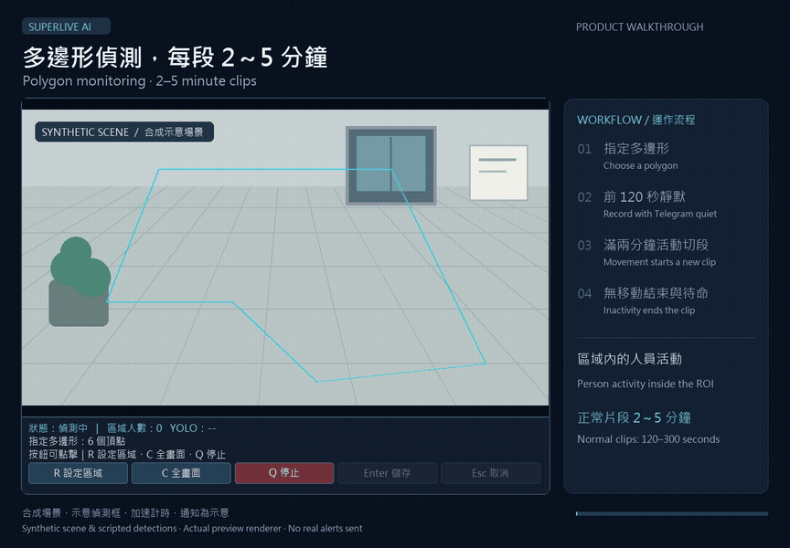
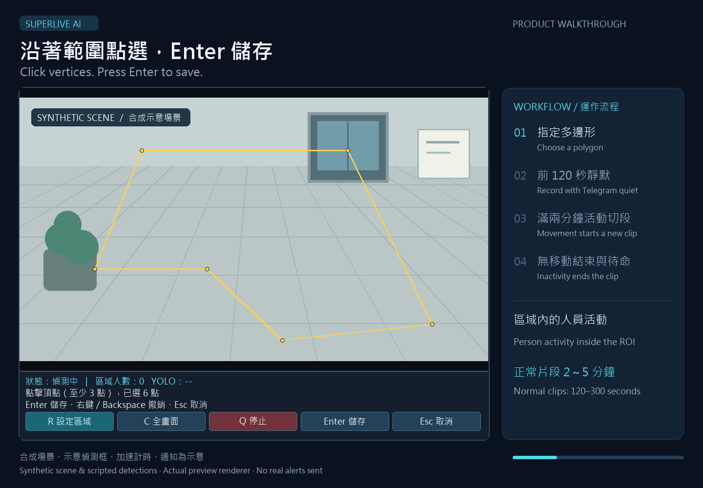
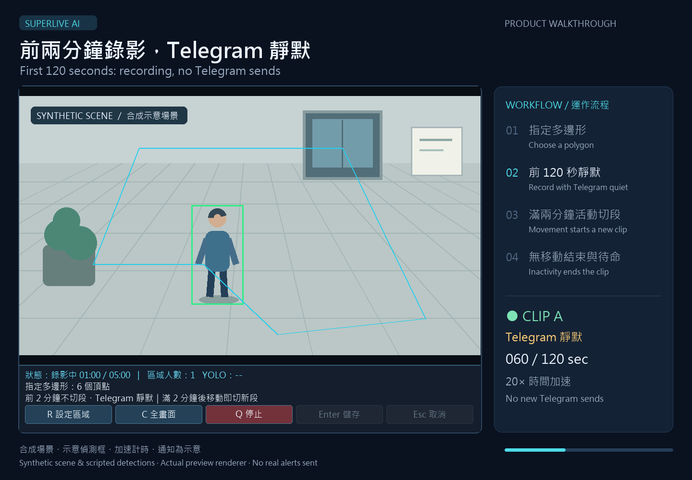
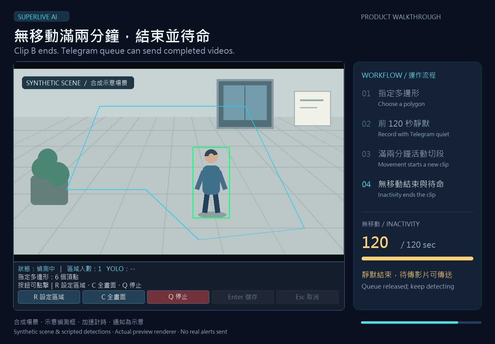

<p align="center">
  <strong>English</strong> · <a href="README.zh-CN.md">简体中文</a> · <a href="README.zh-TW.md">繁體中文</a> · <a href="README.ja.md">日本語</a> · <a href="README.ko.md">한국어</a><br>
  <a href="README.de.md">Deutsch</a> · <a href="README.es.md">Español</a> · <a href="README.fr.md">Français</a> · <a href="README.pt-BR.md">Português (Brasil)</a> · <a href="README.vi.md">Tiếng Việt</a> · <a href="README.id.md">Bahasa Indonesia</a> · <a href="README.it.md">Italiano</a>
</p>

<p align="center"></p>
<h1 align="center">SuperLive AI Monitor</h1>
<p align="center">Choose a polygon. Record person activity. Receive the event on Telegram.</p>
<p align="center">
  
  
  <a href="LICENSE"></a>
</p>
<p align="center">
  <a href="#quick-start">Quick start</a> · <a href="#workflow">Workflow</a> · <a href="#features">Features</a> · <a href="#demo">Demo</a> · <a href="#faq">FAQ</a> · <a href="#documentation">Documentation</a>
</p>

```powershell
powershell.exe -NoProfile -ExecutionPolicy Bypass -File .\installer\INSTALL_FROM_REPO.ps1
```

---

New application icon and high-quality recording: full capture resolution, H.264 CRF 18 locally; Telegram uses CRF 20 first and compresses only oversized delivery copies.

SuperLive AI Monitor adds event recording to a visible SuperLive camera feed in MuMu on Windows. Select a polygon around the area you care about; YOLO detects people there, records their activity and delivers completed videos through Telegram. No camera RTSP URL is required.

This is an unofficial community project, not affiliated with the SuperLive or MuMu vendors.

The 12 README languages translate the documentation. The application preview currently uses Traditional Chinese.

<a id="quick-start"></a>
## Quick start

1. Install MuMu and SuperLive, sign in, and open the intended live camera view. Keep the Windows session logged in.
2. Clone/download this repository. Run `installer\INSTALL_FROM_REPO.bat` or the PowerShell command above.
3. Run `installer\SET_TELEGRAM.bat` to configure your own bot and chat locally. The repository includes no credentials.
4. Run `installer\VERIFY_ALL.bat` with the live view open.
5. Start the deployed `%USERPROFILE%\Downloads\SuperLive_AI\Start_AI_Monitor.bat`; use `Stop_AI_Monitor.bat` to stop.

**Already installed?** Run `installer\UPDATE_FROM_REPO.bat`. The updater backs up and stops the runtime, preserves local region/Telegram/storage settings and leaves it stopped for a deliberate restart. No Windows auto-start, scheduled task or service is created.

<a id="workflow"></a>
## Workflow

```text
New person activity inside the polygon
  → start recording + local Windows alert and snapshot
  → first 120 seconds: keep detecting; no automatic rollover or new Telegram sends
  → movement from 120 seconds until before 300: close this clip and immediately start the next
  → each new clip starts another 120-second Telegram quiet period
  → 120 seconds without movement, or 300-second maximum: close and wait
  → completed videos stay queued until the current quiet period has ended
```

A person first observed after startup counts as new activity. Normal clips last **120–300 seconds**. Before 120 seconds, movement resets the inactivity interval without splitting the clip. From 120 seconds until the 300-second cap, detected movement ends the old clip and starts a new one immediately. Absent and stationary people both count as no movement; after 120 continuous seconds without movement, recording ends and waits for renewed movement or a new arrival.

**Automatic Telegram deliveries include completed videos and daily CSV reports.** Starting a clip keeps the Windows alert and local evidence, but sends no Telegram photo. The queue, including older videos and retries, does not start new Telegram sends during the current clip's first 120 seconds. Repeated rollovers can therefore delay the backlog. A send already dispatched before the quiet period may still arrive; it cannot be recalled.

Manual stop or capture failure may leave a local partial clip shorter than 120 seconds. It is not padded to simulate extra footage and is not automatically sent before its quiet deadline; pending work also waits for any newer clip's quiet period.

Selection or invalid capture/inference is unknown and resets the observation interval. After recovery, valid observations must establish a new inactivity interval.

<a id="features"></a>
## Features

| Feature | Behavior |
| --- | --- |
| Polygon detection | Convex/concave regions; legacy rectangles supported; positive-area person-box overlap required |
| Camera content | Excludes MuMu title/menu area; keeps camera timestamps and channel labels |
| Preview | Clickable controls and status below the image |
| Activity recording | Normal clips 120–300 seconds; movement after 120 seconds rolls over; 120-second inactivity stop |
| Notifications | Local Windows alert and evidence at start; completed videos and daily CSV reports on Telegram |
| Video delivery | Actual-duration H.264 MP4; persistent queue/retries; no new sends during each clip's first 120 seconds |
| Recovery | Capture retry and separate monitor/recorder watchdogs |
| Storage | 10 FPS; `C:\SuperLive_Recordings`; drive rotation at 80% down to 78% |

Movement is a proxy derived from person-box position/size, not pose analysis or a physical sensor. Small jitter is ignored and slow displacement accumulates, but camera movement, occlusion and detection errors can affect it. Videos contain the full cropped camera view, not a polygon-shaped crop.

<a id="demo"></a>
## Demo

These 36-second, silent demonstrations use the **actual preview renderer with a synthetic scene, scripted person boxes and simulated recording states**. Bilingual captions explain the workflow. They are not real camera recordings or evidence of YOLO detection accuracy. The video **compresses the 120-second intervals** to show the initial Telegram quiet period, movement-triggered rollover and subsequent waiting quickly.



[Open or download the MP4 demonstration](docs/media/superlive-demo.mp4)

| Polygon selection | Recording and activity | Inactivity and rearming |
| --- | --- | --- |
|  |  |  |

## Latest changes

Normal clips now last 120–300 seconds. Movement after the first 120 seconds immediately starts a new clip and a fresh Telegram quiet period. Automatic start photos are removed; completed videos and daily CSV reports are delivered, with the whole queue deferred during quiet periods. Polygon detection and the 120-second no-movement stop remain. See the [changelog](CHANGELOG.md).

<a id="controls"></a>
## Controls

| Control | Action |
| --- | --- |
| R / Select | Begin a polygon |
| Left click | Add at least three distinct vertices in boundary order |
| Right click / Backspace | Remove the last vertex |
| Enter / Save | Close and save a valid, non-crossing polygon |
| Esc / Cancel | Keep the previous region |
| C / Full frame | Clear the region restriction |
| Q / Stop | Stop monitoring and finish the current clip |

Keyboard shortcuts require preview focus. Settings persist relative to the camera content. If old coordinates cannot be migrated safely after cropping, select a new region or explicitly choose full frame.

<a id="faq"></a>
## FAQ

**Why does recording stay stopped when someone stands still?** After an inactivity stop, it waits for renewed movement or a new arrival.

**How long is a clip?** Normally 120–300 seconds. Movement at or after 120 seconds rolls into a new clip; inactivity can end the clip before the cap. Manual stop or capture faults can produce shorter local partial files without padding.

**Can it run in VMware?** CPU inference is supported. MuMu needs working nested virtualization; VMware graphics acceleration does not provide CUDA compute. Keep the interactive session and live view available.

**Why has a finished video not arrived?** The current clip's first 120 seconds defer all new Telegram sends, including old retries. Repeated rollovers extend that wait. Network failures also keep videos queued. A request already dispatched before a quiet period can still arrive during it.

<a id="docs"></a>
<a id="documentation"></a>
## Documentation

| Topic | Document |
| --- | --- |
| Daily operation | [English User Guide](docs/USER_GUIDE.md) · [繁中使用指南](docs/USER_GUIDE.zh-TW.md) |
| Internals | [Architecture](docs/ARCHITECTURE.md) · [Recording Design](docs/RECORDING.md) |
| Installation planning | [Hardware](docs/HARDWARE.md) · [VMware](docs/VMWARE.md) |
| Versions and safety | [Baseline](docs/BASELINE.md) · [Changelog](CHANGELOG.md) · [Security](SECURITY.md) |

Code lives in `src/`, public configuration templates in `config/`, and deployment tools in `installer/`. Test the real camera view and Telegram delivery in your own environment; offline tests cannot verify that setup.

## Security

Never commit real tokens/chat IDs, API keys, passwords, sessions, local configuration, logs, event images, recordings or private backups. Before pushing, run the same scanner used by GitHub Actions:

```powershell
python .\scripts\security_scan.py .
```

## License

[MIT](LICENSE).

## Daily CSV · 23:00 Asia/Taipei

At 23:00 Taiwan time, send a CSV covering that day from 00:00 inclusive to 23:00 exclusive and save it beside the videos. Daily CSV delivery is exempt from recording quiet periods. Events after 23:00 are excluded; no midnight supplement. Zero-event days still get a report. Network failures and missed schedules retry after restart.
