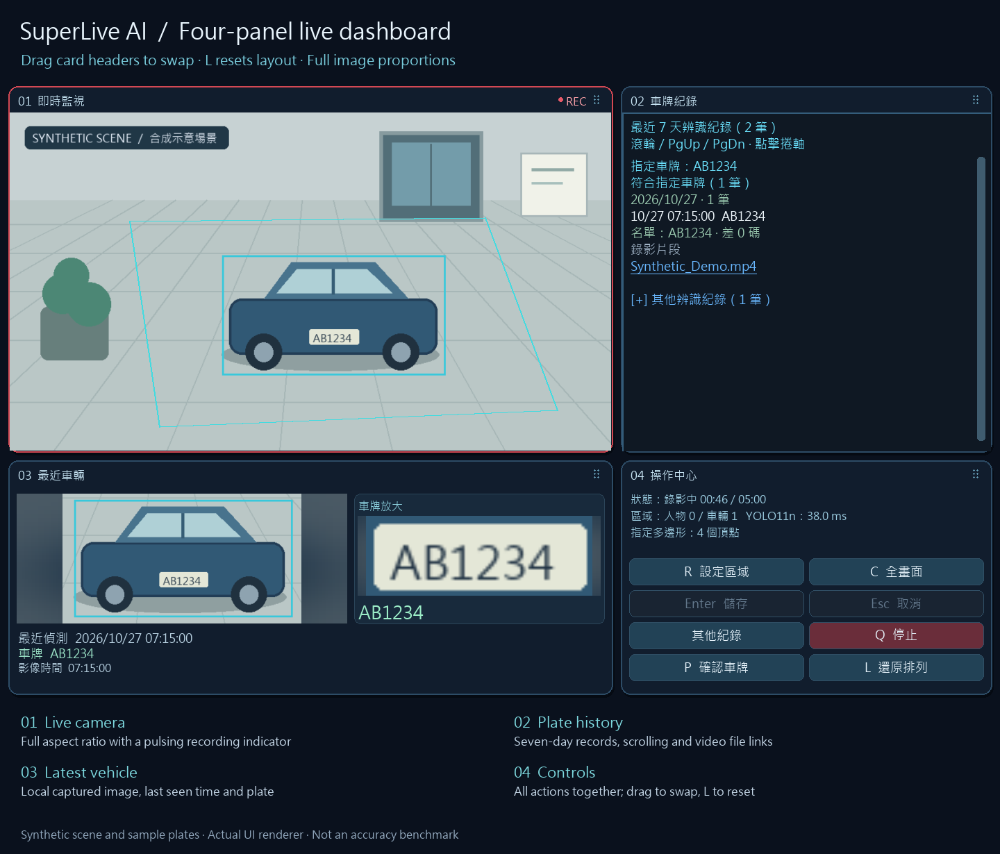

<p align="center">
  <a href="README.md">English</a> · <a href="README.zh-CN.md">简体中文</a> · <a href="README.zh-TW.md">繁體中文</a> · <a href="README.ja.md">日本語</a> · <a href="README.ko.md">한국어</a><br>
  <a href="README.de.md">Deutsch</a> · <a href="README.es.md">Español</a> · <a href="README.fr.md">Français</a> · <a href="README.pt-BR.md">Português (Brasil)</a> · <strong>Tiếng Việt</strong> · <a href="README.id.md">Bahasa Indonesia</a> · <a href="README.it.md">Italiano</a>
</p>
<p align="center"></p>
<h1 align="center">Chụp màn hình camera giám sát để phát hiện chuyển động của người và xe</h1>
<p align="center">SuperLive AI Monitor · Hỗ trợ trình giả lập Android MuMu và MEmu</p>
<p align="center">
  
  
  <a href="LICENSE"></a>
</p>
<p align="center"><a href="#quick-start">Bắt đầu</a> · <a href="#workflow">Quy trình</a> · <a href="#features">Tính năng</a> · <a href="#demo">Minh họa</a> · <a href="#faq">Hỏi đáp</a> · <a href="#documentation">Tài liệu</a></p>

```powershell
powershell.exe -NoProfile -ExecutionPolicy Bypass -File .\installer\INSTALL_FROM_REPO.ps1
```

---

Biểu tượng mới và ghi hình chất lượng cao: giữ độ phân giải thu hình gốc với H.264 CRF 18. Telegram ưu tiên gửi cùng video gốc; chỉ tạo bản nén tạm khi vượt giới hạn dung lượng và xóa bản tạm sau khi gửi thành công.

SuperLive AI Monitor bổ sung khả năng ghi hình theo sự kiện cho hình ảnh trực tiếp của SuperLive trong MuMu trên Windows. YOLO phát hiện người và xe trong vùng đa giác đã chọn và gửi video hoàn tất qua Telegram. Không cần biết địa chỉ RTSP của camera.

Đây là dự án cộng đồng không chính thức, không liên kết với nhà cung cấp SuperLive hoặc MuMu. 12 ngôn ngữ README chỉ là bản dịch tài liệu; giao diện xem trước của ứng dụng hiện vẫn dùng tiếng Trung phồn thể.

**Cập nhật 21/10/2026:** Chuyển động của người hoặc xe (ô tô, xe máy, xe buýt, xe tải) đều có thể kích hoạt ghi hình. Giữ nguyên 120 giây tạm hoãn gửi và video 120–300 giây; CSV hằng ngày là ngoại lệ. Telegram phân biệt người, loại xe và biển số thực sự đọc được; chưa xác nhận sẽ được ghi rõ. OCR quét toàn ảnh cùng các vùng chồng lấp và tự khôi phục khi lỗi. Dùng con lăn, thanh cuộn hoặc PageUp/PageDown để xem tối đa bảy ngày lịch sử, gồm nhận dạng lại video gốc, không đọc được biển số, ứng viên chưa xác nhận và lỗi.

Mặc định chỉ mở các kết quả đã xác nhận khớp danh sách riêng với tối đa hai phép chỉnh sửa ký tự; các kết quả khác được giữ trong mục thu gọn. Nhấp tên video để chọn tệp gốc trong Windows File Explorer.

Trạng thái OCR, chất lượng và tiến độ xử lý vẫn nằm cùng các nút phía dưới. Khi bật nhận dạng biển số, các kết quả khớp luôn hiển thị bên phải, nhóm theo ngày tại Đài Loan kèm số lượng mỗi ngày và xếp mới nhất trước. Với cửa sổ hẹp, danh sách nằm dưới camera; hình ảnh giữ nguyên tỷ lệ. Nút “其他紀錄” mở rộng và chuyển đến các bản ghi khác bên dưới; thu gọn sẽ quay lại các kết quả khớp.


## Giao diện bốn khu vực

Video trực tiếp ở trên trái, lịch sử biển số ở trên phải, ảnh xe gần nhất ở dưới trái và các nút điều khiển ở dưới phải. Kéo tiêu đề để đổi vị trí; nhấn L để đặt lại. Hình minh họa tổng hợp được tạo bằng giao diện thật.



[操作說明 / Guide](docs/DASHBOARD.en.md) · [排列動畫 / Layout animation](docs/media/dashboard-layout.gif)

**Cài đặt trên máy tính mới:** chạy `INSTALL.bat` ở thư mục gốc, sau đó cấu hình ADB, Telegram và biển số trong cửa sổ cài đặt. Góc dưới bên trái hiển thị xe và ảnh biển số phóng to cạnh nhau. [Hướng dẫn tiếng Anh](docs/INSTALL.en.md).

Nhấn **P** để xác nhận biển số và màu xe, lưu vào cơ sở dữ liệu cục bộ. Lần đối chiếu sau hỗ trợ sai khác 1–3 ký tự. [Hướng dẫn tiếng Anh](docs/VEHICLE_DATABASE.en.md).

<a id="quick-start"></a>
## Bắt đầu nhanh

1. Cài MuMu và SuperLive, đăng nhập rồi mở camera cần theo dõi. Giữ phiên người dùng Windows luôn đăng nhập.
2. Sao chép hoặc tải kho mã nguồn. Chạy `installer\INSTALL_FROM_REPO.bat` hoặc lệnh PowerShell ở trên.
3. Chạy `installer\SET_TELEGRAM.bat` để thiết lập bot và cuộc trò chuyện của riêng bạn trên máy. Kho mã nguồn không chứa thông tin xác thực.
4. Khi hình ảnh camera đang mở, chạy `installer\VERIFY_ALL.bat` để kiểm tra chụp hình, tệp, biên dịch Python và bộ mã hóa.
5. Chạy `%USERPROFILE%\Downloads\SuperLive_AI\Start_AI_Monitor.bat`; dùng `Stop_AI_Monitor.bat` trong cùng thư mục để dừng.

**Đã cài đặt trước đó?** Chạy `installer\UPDATE_FROM_REPO.bat`. Công cụ cập nhật sao lưu và dừng chương trình, giữ nguyên thiết lập vùng, Telegram và lưu trữ trên máy. Kiểm tra camera rồi khởi động lại thủ công. Không tạo dịch vụ, tác vụ theo lịch hoặc tự khởi động cùng Windows.

<a id="workflow"></a>
## Quy trình hoạt động

```text
Có hoạt động mới của người hoặc xe trong vùng đa giác
  → bắt đầu ghi, thông báo Windows và ảnh lưu trên máy
  → 120 giây đầu: không tự chuyển đoạn, không bắt đầu lượt gửi Telegram mới
  → có chuyển động từ giây 120 đến trước 300: kết thúc đoạn cũ và ghi đoạn mới ngay
  → mỗi đoạn mới bắt đầu lại 120 giây tạm hoãn gửi Telegram
  → liên tục 120 giây không chuyển động hoặc đạt 300 giây: kết thúc và chờ
  → video hoàn tất chờ trong hàng đợi đến khi hết thời gian tạm hoãn hiện tại
```

Người hoặc xe được nhìn thấy lần đầu sau khi khởi động được tính là hoạt động mới. Video tự động hoàn tất bình thường dài **120–300 giây**. Trước giây 120, chuyển động đặt lại thời gian không chuyển động nhưng không chia đoạn. Từ giây 120 đến trước giới hạn 300, phát hiện chuyển động sẽ kết thúc đoạn hiện tại và bắt đầu đoạn mới ngay. Không có đối tượng hoặc tất cả đối tượng đứng yên đều tính là không chuyển động; sau 120 giây liên tục không chuyển động, chương trình dừng ghi và chờ chuyển động mới hoặc người mới xuất hiện.

**Video hoàn tất, biển số đã xác nhận và báo cáo CSV hằng ngày được gửi tự động qua Telegram.** Khi bắt đầu ghi, chương trình giữ thông báo Windows và ảnh lưu trên máy, không gửi ảnh bắt đầu qua Telegram. Trong 120 giây đầu của đoạn hiện tại, không bắt đầu lượt gửi mới, kể cả video cũ và lượt thử lại. Chuyển đoạn liên tục có thể kéo dài thời gian chờ của hàng đợi. Yêu cầu mạng đã gửi trước thời gian tạm hoãn vẫn có thể đến trong khoảng này và không thể thu hồi.

Dừng thủ công hoặc lỗi chụp hình có thể để lại đoạn video cục bộ ngắn hơn 120 giây. Chương trình không thêm hình để tạo thời lượng giả; việc gửi tự động phải chờ hết hạn tạm hoãn của đoạn đó và cả thời gian tạm hoãn của đoạn mới hơn, nếu có.

Khi đang chọn vùng, chụp hình thất bại hoặc không có kết quả phát hiện hợp lệ, trạng thái được xem là chưa xác định và khoảng quan sát được đặt lại, không được tính là đã xác nhận không có chuyển động.

<a id="features"></a>
## Tính năng

| Tính năng | Hoạt động |
| --- | --- |
| Vùng theo dõi | Hỗ trợ đa giác lồi, lõm và thiết lập hình chữ nhật cũ |
| Phát hiện | Phát hiện người và xe; khung đối tượng phải chồng lên vùng với diện tích lớn hơn 0, chạm biên là chưa đủ |
| Hình ảnh | Loại bỏ thanh tiêu đề/menu MuMu; giữ thời gian và tên kênh trong hình camera |
| Ghi hình | Bình thường 120–300 giây; chuyển động sau giây 120 mở đoạn mới; dừng sau 120 giây liên tục không chuyển động |
| Gửi kết quả | Thông báo và ảnh cục bộ khi bắt đầu; Telegram gửi video H.264 MP4 và báo cáo CSV hằng ngày, hàng đợi và lượt thử lại chờ hết thời gian tạm hoãn |
| Lưu trữ | 10 FPS; `C:\SuperLive_Recordings`; xóa video cũ khi ổ đĩa đạt 80%, dừng khi còn 78% |
| Khôi phục | Thử chụp lại; bộ giám sát riêng cho chương trình theo dõi và ghi hình |

Chuyển động được ước tính từ vị trí/kích thước khung người hoặc xe, không phải phân tích tư thế. Rung nhẹ của khung được lọc, còn dịch chuyển chậm được tích lũy. Camera chuyển động, che khuất và lỗi phát hiện vẫn có thể ảnh hưởng kết quả. Video giữ toàn bộ phần hình ảnh camera đã cắt, không cắt theo hình đa giác.

<a id="demo"></a>
## Minh họa

Minh họa **36 giây không có âm thanh** dùng bộ dựng giao diện xem trước thật, cảnh tổng hợp, khung người theo kịch bản và trạng thái ghi hình mô phỏng, kèm phụ đề song ngữ. Các khoảng **120 giây được rút ngắn** để minh họa thời gian chưa gửi Telegram và chuyển đoạn khi có chuyển động. Đây không phải video camera thật hay bằng chứng về độ chính xác của YOLO.


[Mở hoặc tải video minh họa MP4](docs/media/superlive-demo.mp4)

| Chọn đa giác | Ghi hoạt động | Không chuyển động và chờ ghi lại |
| --- | --- | --- |
|  |  |  |

<a id="controls"></a>
## Điều khiển

| Thao tác | Chức năng |
| --- | --- |
| R / chọn vùng | Bắt đầu vẽ đa giác |
| Nhấp chuột trái | Thêm ít nhất ba đỉnh khác nhau theo thứ tự đường biên |
| Chuột phải / Backspace | Xóa đỉnh cuối |
| Enter / lưu | Khép và lưu đa giác có diện tích, các cạnh không cắt nhau |
| Esc / hủy | Giữ vùng trước đó |
| C / toàn khung hình | Bỏ giới hạn vùng |
| Q / dừng | Dừng theo dõi và hoàn tất video hiện tại |

Phím tắt yêu cầu cửa sổ xem trước đang được chọn. Vùng được lưu bằng tọa độ tương đối so với hình camera. Nếu không thể chuyển đổi an toàn vùng cũ, hãy chọn lại hoặc chủ động chọn toàn khung hình.

<a id="faq"></a>
## Câu hỏi thường gặp

**Vì sao người đứng yên không kích hoạt ghi lại?** Sau khi dừng do không chuyển động, cần có chuyển động mới hoặc người mới xuất hiện. **Mỗi đoạn dài bao lâu?** Bình thường 120–300 giây; chuyển động sau giây 120 mở đoạn mới. Sự cố có thể để lại tệp cục bộ ngắn hơn, không thêm hình để kéo dài giả tạo.

**Có chạy trên VMware không?** Có thể suy luận bằng CPU. MuMu cần ảo hóa lồng nhau hoạt động; tăng tốc đồ họa VMware không cung cấp CUDA. **Vì sao chưa nhận được video?** Thời gian tạm hoãn hiện tại chặn lượt gửi mới và thử lại, kể cả video cũ; chuyển đoạn liên tục kéo dài thời gian chờ. Lỗi mạng cũng giữ video trong hàng đợi. PASS về cấu hình chỉ có nghĩa là tệp tồn tại; dùng `SET_TELEGRAM.bat` để thiết lập và kiểm tra việc nhận thực tế.

<a id="docs"></a>
<a id="documentation"></a>
## Tài liệu và bảo mật

[Hướng dẫn tiếng Anh](docs/USER_GUIDE.md) · [Hướng dẫn tiếng Trung phồn thể](docs/USER_GUIDE.zh-TW.md) · [Kiến trúc](docs/ARCHITECTURE.md) · [Ghi hình](docs/RECORDING.md) · [Phần cứng](docs/HARDWARE.md) · [VMware](docs/VMWARE.md) · [Thay đổi](CHANGELOG.md) · [Bảo mật](SECURITY.md)

Mã nguồn nằm trong `src/`, mẫu cấu hình trong `config/`, công cụ cài đặt trong `installer/`. Không đăng thông tin xác thực, nhật ký, ảnh sự kiện, video hoặc bản sao lưu riêng tư. Trước khi đẩy mã, chạy `python .\scripts\security_scan.py .`. Kiểm thử ngoại tuyến không thay thế việc xác nhận với camera và tài khoản Telegram thật của bạn.

## Giấy phép

[MIT](LICENSE).

## Daily CSV · 23:00 Asia/Taipei

Lúc 23:00 (giờ Đài Loan), gửi CSV cho khoảng từ 00:00 đến trước 23:00 trong ngày và lưu cùng video. CSV hằng ngày được miễn thời gian im lặng khi ghi hình. Không tính sự kiện sau 23:00 và không gửi bản bổ sung lúc nửa đêm. Vẫn báo cáo khi không có sự kiện; thử lại sau lỗi hoặc khởi động lại.
