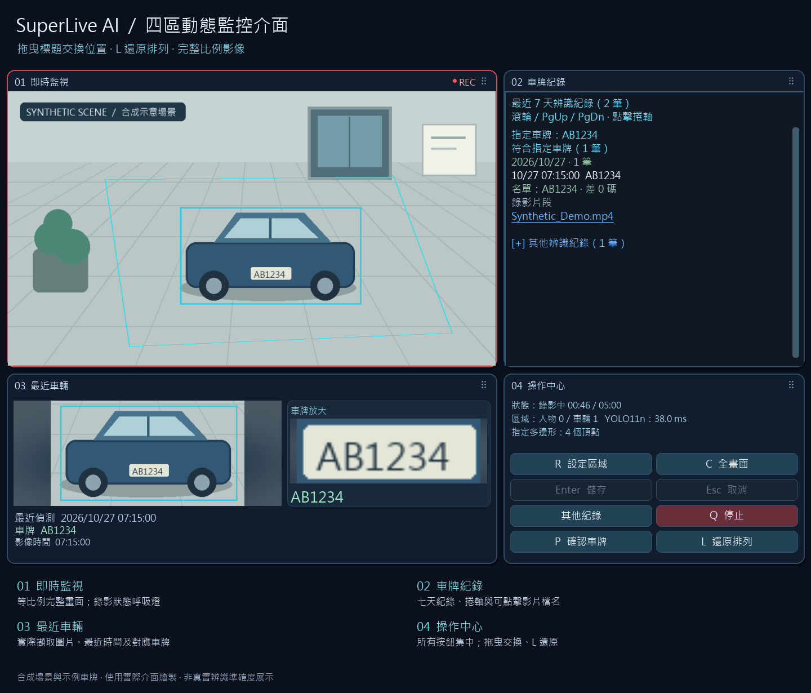
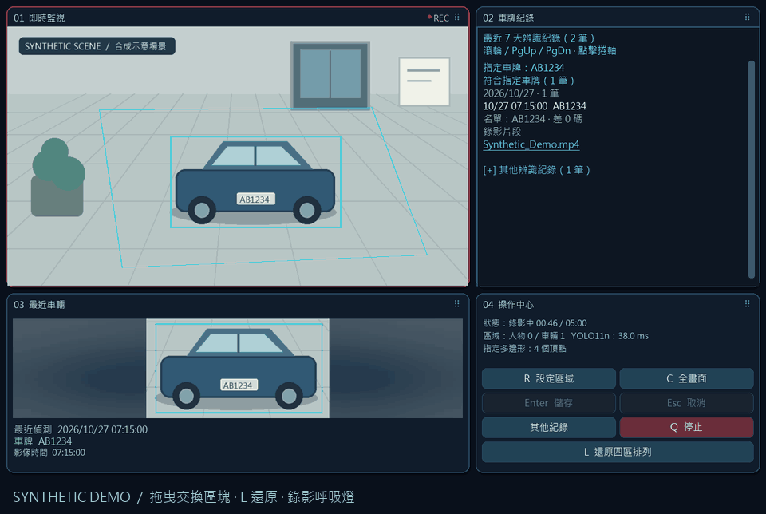

# 四區監控介面使用說明

圖中的車輛、車牌及辨識紀錄均為合成示例，不是真實攝影機畫面或辨識準確率測試。

| 預設位置 | 功能 | 操作 |
| --- | --- | --- |
| 左上：即時監視 | 完整攝影機畫面及多邊形；錄影時紅色邊框與 REC 呼吸燈 | 按 R 後只在實際畫面內點選頂點，Enter 儲存 |
| 右上：車牌紀錄 | 七天紀錄依日期整理，其他結果可收折 | 滾輪、PgUp／PgDn 或捲軸；點影片檔名開啟資料夾並選取檔案 |
| 左下：最近車輛 | 最近一次偵測時間、對應車牌及車輛截圖 | 圖片另外標示擷取時間；同時出現多台車時，截圖包含該組車輛 |
| 右下：操作中心 | 區域、全畫面、儲存、取消、其他紀錄、停止及還原排列 | 所有按鈕集中在此；未進入選取模式時，儲存與取消為停用狀態 |

## 排列與縮放

按住任一區塊上方的標題列，拖到另一區塊後放開，即可交換位置。拖曳時會亮起目標邊框；拖曳中按 Esc 取消，不會停止監控。按 **L** 或「還原四區排列」回到預設位置。排列保存在本機 `runtime/preview_layout.json`，重新啟動仍保留。

視窗縮放時，四區會重新計算尺寸。版面最小畫布為 640 × 720，建議視窗至少 1280 × 820。攝影機畫面及車輛圖片維持比例，不拉伸；比例不符時，以柔化背景填滿區塊。背景補齊部分不是可選取的攝影機座標，不會加入 ROI 或錄影內容。動畫只作用於介面邊框與按鈕，不會寫進原始錄影。

## 車輛圖片與隱私

圖片取自成功擷取且偵測到車輛的原始影格，裁出車輛群並留少量周邊；最長邊受 960 × 540 的顯示上限限制，錄影解析度不受此縮圖限制。最多每秒更新一次，車輛離開後保留最後一張；沒有可信影像時顯示等待圖片，不放入其他影片的圖片。

最近圖片在本機 `runtime/latest_vehicle.jpg`，對應時間與圖片雜湊在 `runtime/latest_vehicle.json`。重啟會先核對，若圖片與紀錄不一致就不顯示圖片。新車群會清除舊車牌與舊圖片關聯。這些檔案、攝影機名稱及私人車牌設定不應加入 GitHub。公開文件只含 `scripts/generate_dashboard_demo.py` 產生的合成圖片。

## 通知規則

車牌持續從即時串流的影格辨識，移動或靜止皆可，未錄影時也辨識；不讀取歷史影片。多影格確認後立即通知，同一實際車牌三分鐘內最多通知一次，不同車牌各自計時。影片完成後依錄影時間先後傳送，影片上傳與車牌通知分開運作。

## 套用更新

已有待套用更新套件時，執行安裝目錄中的 `套用Telegram更新.bat`；它也包含這次介面更新。更新會保留本機設定、原片、辨識紀錄與私人車牌名單。此專案的公開安裝程序請見 [README](https://github.com/tonykfr1234/superlive-ai-monitor/blob/main/README.zh-TW.md#quick-start)。

重新生成圖解：`python scripts/generate_dashboard_demo.py`。只使用合成影像及實際介面繪圖函式，不開啟模擬器、不載入辨識模型，也不發送 Telegram。

最新安裝與車牌顯示：左下角左側為車輛照片，右側為同一車輛的車牌放大圖與辨識文字。照片取自實際辨識影格，沒有可信裁切時顯示提示；設定與人工校正見 [一鍵安裝說明](INSTALL.zh-TW.md)。

## 人工確認與 1～3 碼資料庫比對

右下「P 確認車牌」可開啟固定圖片，確認正確號碼與車色，長期儲存於本機資料庫。後續在設定容錯內優先匹配資料庫，保留原始讀值；多個候選無法唯一判斷時維持待確認。詳見 [人工確認車牌與車色資料庫](VEHICLE_DATABASE.zh-TW.md)。
