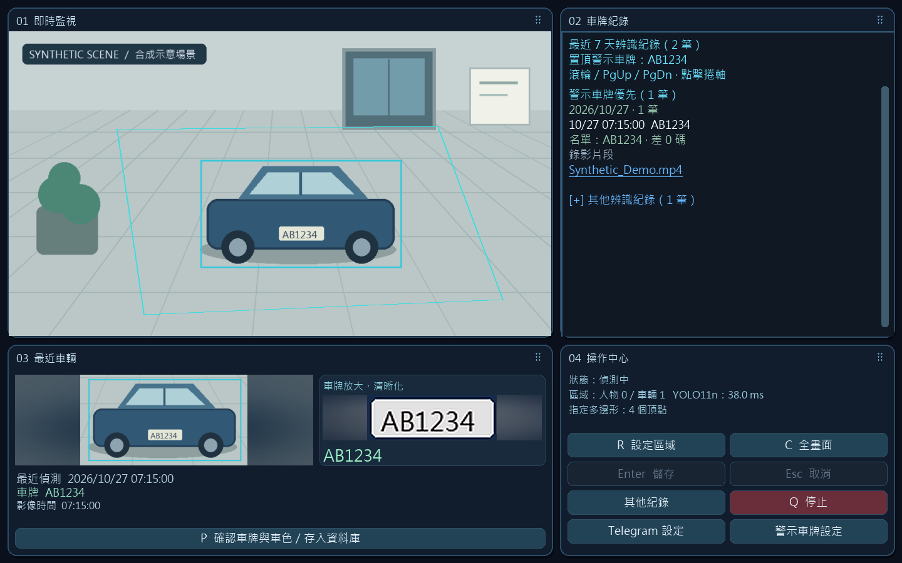
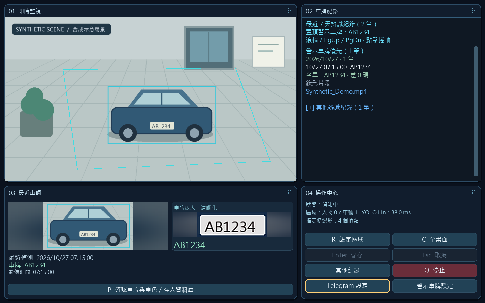

# 預覽介面鍵盤改善與本機驗證

基準 `cfc0459fda00b852678a34b2a90beef79ab6373a`，本機分支 `codex/ui-ux-20261029`。這次只改善 `PreviewController` 與真實 Pillow/OpenCV 預覽 renderer 的鍵盤操作，沒有部署、安裝、接觸真實攝影機、錄影或 Telegram。

Tab 依目前卡片／按鈕的視覺順序移動焦點，跳過無法使用的操作。Enter／Space 啟動目前焦點操作；沒有焦點時保留原本 ROI 儲存快捷鍵。滑鼠點擊與直接快捷鍵清除舊焦點，避免後續 Enter 誤啟動前一個按鈕。3px 暖色框清楚標示目前焦點；卡片重新排列後仍依視覺順序巡覽。

## 真實 renderer 的合成輸出

這些圖是專案原有 renderer 繪製合成像素的實際結果，不是設計稿，也不是作業系統視窗截圖或相機影像。

| 修改前 | 修改後 |
|---|---|
|  |  |

本機 audit 保存 640×720、800×760、1440×900、1920×1080 各5狀態，20張before與20張after。這是桌面 renderer 輸出像素，不是CSS viewport、iOS pt或Android dp；沒有手機真機認證，也沒有原生螢幕閱讀器驗證。

## 已驗證與未通過項目

- `unittest-preview.txt`：28/28 通過，含5個新鍵盤案例與23個既有預覽案例。涵蓋全部24種卡片順序、跳過disabled、Enter／Space、焦點框像素、保留原始影像，以及ROI儲存操作。
- `unittest-dashboard-workspace-temp.txt`：9/9 通過，涵蓋卡片重排與影像區域座標；使用工作區合成檔案，不操作個人資料。
- 全套 `unittest-full-workspace-temp.txt`：執行571項，**31 errors、1 skipped，整套未通過**。紀錄包含缺 `requests`／`imageio_ffmpeg` 等依賴而無法匯入測試模組；未安裝套件，也沒有以通過的專項測試取代完整結果。
- Python AST 語法與 `git diff --check` 通過。專案未配置獨立 lint／type gate；沒有宣稱執行。
- 既有 Python3.13 可執行合成 renderer。使用者原安裝venv指向失效Python3.12，未修改或修復該環境。

原生Windows鍵盤端到端驗證尚未完成：測試用視窗 `SuperLive synthetic UI audit - before` 已啟動，但 Computer Use 的 `getApp({windowId:1250650})` 在批准介面逾時，沒有取得控制；未重試。這不是auto-review拒絕或usage limit。controller層測試不能證明OpenCV/Windows實際鍵碼、Shift+Tab或完整GUI可存取性已通過。

因此本次為本機UI候選，不能視為完整產品或發布驗收通過。人車事件、錄影播放、儲存上限、斷線恢復、通知與真實相機整合仍待具備依賴的隔離環境驗證。

## 重跑與回復

可使用既有Python環境在repo執行：

```powershell
python -m unittest discover -s tests -p 'test_preview*.py' -v
python -m unittest discover -s tests -p 'test_dashboard.py' -v
```

需要已存在的NumPy／Pillow；不會自動安裝。完整合成影像矩陣的第一方腳本保存在本機 `audit/superlive-ai-monitor/render_matrix.py`。

保留其他工作後用 `git revert <本次UI commit>`，或從上述baseline建立獨立分支。`audit/superlive-ai-monitor` 保留baseline.bundle、候選bundle、patch、測試logs及40張renderer輸出，hash與最終commit記在delivery.json。不要reset/clean覆蓋未提交工作。

設計依據為靜態閱讀的UI/UX Pro Max鍵盤焦點／清楚互動規則；保留原深色監控介面與既有產品結構，未執行第三方skill腳本。

## 發布準備複查

安全掃描最初拒絕上述兩張 PNG，原因是它們尚未列入專案的精確媒體路徑白名單。核對生成器與實際圖像後，只加入這兩個已驗證的合成 renderer 輸出；保留 PNG 格式、50 MB 大小上限及內嵌秘密檢查，未開放整個目錄或副檔名。

- 安全回歸測試：15/15 通過；repository security scan 通過。
- 既有 `tests/test_deployment.ps1` 隔離 fixture 通過，驗證設定保留、備份、檔案對應與安全預設。沒有安裝依賴、啟動正式監控或呼叫 Telegram。
- 本機完整套件所缺的 Python 依賴尚未安裝，先前 31 errors 結果仍保留。發布候選須等待確切 PR head 的既有 Windows CI 完整測試；不能把主分支舊 CI 或局部測試當作本次完整通過。
- `SHA256SUMS.txt` 更新為候選 Git index 的 committed bytes，包含新增文件、兩張合成圖及鍵盤回歸測試；Windows checkout 的換行轉換不作為 hash 基準。

原生鍵盤、讀屏、真實攝影機及正式部署限制仍如上；草稿 PR 與合併狀態另依 GitHub 的當前結果判定。
