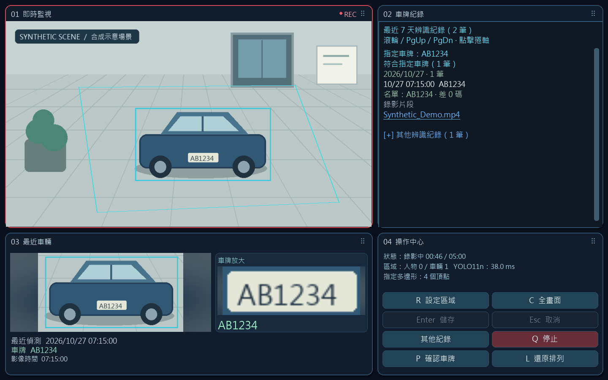
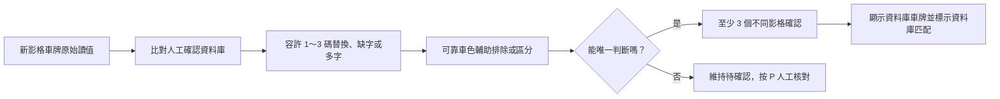

# 人工確認車牌與車色資料庫

## 確認尚未讀清楚的車牌

1. 左下角顯示最近車輛、對應的車牌放大圖；尚未達到自動確認條件的讀值會標示「待確認」。
2. 按右下角 **「P 確認車牌」** 或鍵盤 **P**。程式固定當時的圖片，在另一個視窗開啟，監控與錄影繼續運作。
3. 同時有多台車時，先選取正確的車輛。核對圖片，輸入正確車牌，選擇車身顏色；顏色不明請選「不確定」。
4. 設定資料庫的 **1、2 或 3 碼容錯**（預設 3），可勾選「搭配車色比對」，再按「確認並儲存到資料庫」。
5. 正確車牌會長期保存在本機。若目前仍是相同車輛群，左下角立即更新；若畫面已換車，僅更新資料庫，不把舊車牌套在新車上。

人工確認當下不補發 Telegram，也不重新處理歷史影片。後續新的即時辨識會讀取更新後的資料庫，不必重新啟動監控。

## 後續如何優先匹配

- 英文不分大小寫，連字號不計入差異；至少需要 4 個可用英數字元才進行資料庫比對。
- 差異在設定範圍內時，優先使用唯一的資料庫車牌。原始 OCR 讀值仍保留，不會被覆寫。
- 色彩資訊必須來自車牌所屬的唯一車輛；多台重疊、低光或近乎黑白的影像不強行猜車色。白、銀、灰視為相近色組，避免亮度差異造成過度排除。
- 多個候選同樣接近且車色無法分辨，或可靠車色與候選衝突時，保留待確認。車色會受燈光、反光及攝影機影響，只是輔助線索。
- 所有資料庫自動匹配仍需至少三個獨立、位置連續的影格。這是依已確認資料推定車牌，不等於 OCR 直接讀出完整號碼；GUI 與 Telegram 會標示「資料庫匹配」，Telegram 同時保留原讀值。
- 同一資料庫車牌的不同誤讀共用三分鐘通知間隔；資料庫推定結果不會回灌成新的正確學習樣本。

沒有可用的資料庫候選時，沿用一般 OCR 確認及原有本機校正規則。這份資料庫的 1～3 碼設定，與既有特別標示名單的兩碼比對分開運作。

## 管理與保存

確認視窗下方列出已確認車牌、車色及啟用狀態。誤存的號碼可選取後按「停用選取的資料庫車牌」；重新確認同一車牌可恢復或更新顏色。修改正確號碼時，停用錯誤條目，再確認正確號碼。

資料庫位於安裝目錄的 **`config/vehicle_registry.sqlite3`**，採 SQLite 交易儲存車牌、顏色、比對設定及人工確認稽核紀錄；不因七天辨識紀錄到期而刪除。確認視窗使用的固定圖片位於 `runtime/plate_reviews`，保留七天；它們不是重新辨識歷史影片。

更新前請關閉人工確認視窗。程式更新保留本機資料庫；公開專案忽略資料庫及其 WAL／SHM 檔，發布掃描也會拒絕這些檔案。真實車牌、車色紀錄、確認圖片與資料庫不得上傳 GitHub。
